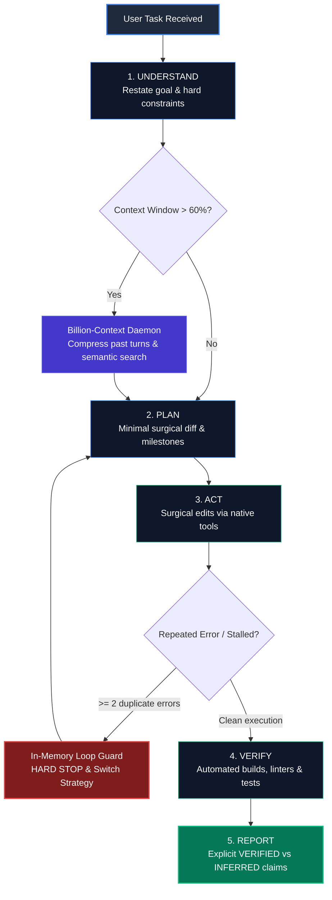

# Local-Model-Booster (for Bionic & Claude Code with LM Studio)

<div align="center">

[](LICENSE)
[](README.md)
[](README.md)
[](README.md)
[](README.md)
[](README.md)
[](docs/CLAUDE_CODE.md)
[](README.md)

</div>

> **Supercharge local 27B-class LLMs (Qwen3.8-27B Uncensored HauhauCS Aggressive MTP on RTX 3090 24GB + 32GB RAM) into disciplined, high-speed, evidence-driven autonomous software engineers — fully compatible with both the Bionic GUI Agent and Anthropic's Claude Code CLI using LM Studio & Billion-Context.**

---

## 🧭 Multi-OS Compatibility Notice

> [!NOTE]
> **Currently Optimized for Windows**: The automated 1-click installer (`.bat`, `.ps1`), Windows Scheduled Tasks, and CLI launchers (`bt.cmd`) are tailored for Windows 10/11 x64 systems.
>
> 🐧 🍎 **Linux / macOS Support**: The core skills, architectural principles, Mermaid flows, and Billion-Context proxy are cross-platform compatible. Native Bash scripts and systemd / launchd service templates are planned and community contributions are warmly welcomed!

---

## 🏛️ Master Architecture & Execution Flow

The core engine operates on a disciplined 5-phase loop with integrated context compression and in-memory zero-loop protection:



---

## 🌟 Highlights & Key Features

- **Master Skill (`bionic-booster`)**: An all-in-one consolidated Bionic skill implementing the strict `UNDERSTAND -> PLAN -> ACT -> VERIFY -> REPORT` execution loop, razor-sharp thinking ceilings, and surgical diff editing.
- **Qwen 3.8 Reasoning Ceilings**: Calibrated thinking budgets (500–4,000 tokens) that prevent reasoning loops and eliminate KV cache bloat across 50+ conversation turns (preserve_thinking: true safe).
- **128K Context (131,072 tokens) + Billion-Context Proxy**: Seamless coordination between the 128K native context window (`q8_0` KV cache + Flash Attention) and the local [Billion-Context](https://github.com/ranxianglei/billion-context) proxy daemon for hierarchical memory compression and semantic retrieval.
- **In-Memory Zero-Loop Guard**: Hard-coded in-memory break rule (stops immediately if the same tool call or error occurs twice) without spawning external shell scripts.
- **6 Production-Tuned Profiles**: Ready-to-use configurations for Coding (`01_coding` default), Tool Use, General Operation, Long Tasks, Max Intelligence, and Max Speed.
- **Claude Code CLI + Billion-Context Integration**: Complete setup guide and PowerShell launcher to connect Anthropic's official Claude Code CLI directly into your local LM Studio / Bionic server through Billion-Context real-time compression ([docs/CLAUDE_CODE.md](docs/CLAUDE_CODE.md)).
- **35 Windows CLI Helper Tools (`bt.cmd`)**: Safe, capped tools for repo mapping (`bt repo-map`), symbol search (`bt find-symbol`), test running (`bt run-checks`), VRAM monitoring (`bt gpu-status`), and git checkpoints.
- **Turnkey 1-Click Automated Installer**: A zero-config automated setup script (`installer/install.bat`) that installs the Billion-Context daemon, registers the background service, deploys profiles, and installs Bionic skills automatically.

---

## 🚀 Quick Start (1-Click Automated Setup)

Ensure **Bionic / LM Studio** is installed and the target model (`Qwen3.8-27B-Uncensored-HauhauCS-Aggressive-Q4_K_P.gguf`) is downloaded.

Simply run:
```cmd
installer\install.bat
```
*(Or via PowerShell: `powershell -ExecutionPolicy Bypass -File installer\install.ps1`)*

### What the 1-Click Installer Does:
1. Installs and configures the **Billion-Context daemon** on port `8787` and registers the silent Windows Scheduled Task `BiliProxyService` (auto-starts on boot).
2. Configures the `billion-context` MCP server in `~/.lmstudio/mcp.json`.
3. Deploys all 6 tuned JSON profiles to `C:\tools\profiles\`, installs desktop `.bat` switchers, and activates `01_coding` as default.
4. Deploys the master **`bionic-booster`** and all 33 modular skills to `~/.lmstudio/skills\`.
5. Adds `C:\tools\` to the Windows User & Machine `PATH` so `bt <tool>` works anywhere.

---

## 🧭 Supported Agent Frontends

Local-Model-Booster supports two first-class autonomous agent interfaces:

### 1. 🤖 Bionic Agent (LM Studio GUI)
1. Open **Bionic** $\rightarrow$ Click **Settings** (gear icon bottom left) $\rightarrow$ **Skills** (*Compétences Bionic*).
2. **Recommended Setting**: Leave **ONLY `Bionic Booster`** checked (uncheck the other modular skills to avoid injecting ~5,000 characters of extra descriptions into every prompt).
3. The master `Bionic Booster` skill already includes:
   - Operating rules & 5-phase loop
   - Thinking budget ceilings
   - 128K context & Billion-Context proxy coordination
   - In-memory zero-loop guard
   - Precise surgical code editing
   - Direct access to the 35 CLI helper tools (`C:\tools\bt.cmd`)
4. Any modular skill can still be summoned on-demand anytime in chat by typing `@<skill-name>`.

### 2. ⚡ Claude Code CLI (Anthropic Terminal Agent)
Anthropic's official **Claude Code CLI** runs seamlessly against your local LM Studio / Bionic server using **Billion-Context** real-time conversation compression:
1. **Proxy Config**: Set `context: 98304` in `~/.config/billion-context/billion-context.json`.
2. **Claude Config**: Configure `ANTHROPIC_BASE_URL: "http://127.0.0.1:8787/bili/http://127.0.0.1:1235"` and map model tiers in `~/.claude/settings.json`.
3. **One-Command Launch**: Add the provided PowerShell helper functions to `$PROFILE` and launch with `bclaude`.
📖 *See the step-by-step reproduction and verification guide in [docs/CLAUDE_CODE.md](docs/CLAUDE_CODE.md).*

---

## 🛠️ Hardware & Profiles Reference

| Profile | ID | Context | Reasoning Budget | Temp / Top_P | KV Cache | Purpose |
| :--- | :--- | :--- | :--- | :--- | :--- | :--- |
| **Coding (Default)** | `01_coding` | 131,072 | 16,384 | 0.6 / 0.95 | `q8_0` | High-precision coding, bug fixing, refactoring, and general chat. |
| **General Operation** | `02_general_operation` | 98,304 | 8,192 | 0.7 / 0.80 | `q8_0` | Fast interactive assistant, balanced reasoning. |
| **Tool Use** | `03_tool_use` | 98,304 | 4,096 | 0.3 / 0.90 | `q8_0` | Strict JSON schema adherence, deterministic tool arguments. |
| **Long Tasks** | `04_long_tasks` | 131,072 | 8,192 | 0.5 / 0.90 | `q4_0` | Massive codebases (>50K tokens); maximizes VRAM safety. |
| **Max Intelligence** | `05_max_intelligence` | 131,072 | 24,576 | 0.7 / 0.95 | `q8_0` | Complex algorithm design, difficult proofs, deep reasoning. |
| **Max Speed** | `06_max_speed` | 65,536 | 0 (Off) | 0.7 / 0.80 | `q8_0` | Maximum throughput (~68-75 t/s), direct instruct generation. |

Switch profiles anytime via `C:\tools\switch_*.bat` desktop shortcuts or `switch_profile.ps1 -Profile <name>`.

---

## 📂 Repository Structure

```text
Local-Model-Booster/
├── .github/
│   ├── ISSUE_TEMPLATE/
│   │   ├── bug_report.yml        <-- Structured bug reporting form
│   │   └── feature_request.yml   <-- Feature & profile suggestion form
│   └── PULL_REQUEST_TEMPLATE.md  <-- Clean pull request checklist
├── installer/
│   ├── install.bat               <-- 1-Click double-click Windows installer
│   ├── install.ps1               <-- Complete PowerShell setup automation
│   └── README.md                 <-- Installer guide
├── skills/
│   ├── bionic-booster/           <-- Master all-in-one Bionic booster skill
│   ├── booster-core/             <-- Core operating system & skill router
│   └── [31 Modular Skills]/      <-- Specialized skills (loop-guard, context, etc.)
├── configs/
│   ├── profiles/                 <-- 6 tuned JSON profile configs
│   └── LMSTUDIO-3090-TUNING.md   <-- Verified hardware and VRAM benchmarks
├── tools/                        <-- 35 Windows CLI helper tools (bt.cmd, repo-map, etc.)
├── templates/                    <-- STATE.md, PLAN.md, MEMORY.md templates
├── docs/
│   ├── Tutorial.md               <-- Complete step-by-step guide
│   ├── CLAUDE_CODE.md            <-- Claude Code + LM Studio + Billion-Context setup guide
│   ├── TEST_PROMPTS.md           <-- Verification prompts for each profile
│   ├── DIAGRAMS.md               <-- Mermaid workflow diagrams for every skill
│   └── TOOLS.md                  <-- CLI tools reference manual
├── scripts/
│   └── validate_skills.py        <-- Automated skill validation script
└── LICENSE                       <-- MIT License
```

---

## 🧪 Automated Skill Validation (`validate_skills.py`)

A built-in Python test suite is provided to ensure all Bionic skills conform to strict quality, formatting, and tool-linkage standards.

### When to run it:
- **Before opening a Pull Request or committing changes** to any skill in `skills/`.
- **After adding a new modular skill** or editing `SKILL.md` frontmatter.
- **After modifying or adding tools** in `tools/` to ensure no broken `bt <tool>` references exist.

### What it checks automatically:
1. **Frontmatter Integrity**: Verifies valid YAML headers, exact folder/name matches, and allowed keys.
2. **Description Quality**: Ensures description lengths are between 40 and 1,024 characters for clear agent router matching.
3. **Mermaid Flowchart Presence**: Verifies every skill folder contains an associated architectural `diagram.mmd`.
4. **Tool Linkage (`bt` references)**: Scans every `SKILL.md` for references to `bt <tool>` and verifies the corresponding PowerShell script exists in `tools/<tool>.ps1`.

### How to execute:
```bash
python scripts/validate_skills.py
```
*Expected output when all 33 skills pass:*
```text
33 skills, 100425 chars
OK
```

---

## 📜 Acknowledgements & Credits

- **[Billion-Context](https://github.com/ranxianglei/billion-context)** by [ranxianglei](https://github.com/ranxianglei) (MIT License): An outstanding, lightweight context compression proxy that makes true long-context reasoning possible on consumer hardware. We are deeply grateful to the developers for building this great tool!
- **[HauhauCS](https://huggingface.co/HauhauCS)**: Creator of the `Qwen3.8-27B-Uncensored-HauhauCS-Aggressive-MTP-GGUF` model and custom `Q4_K_P` quants.
- **[Qwen Team / Alibaba](https://github.com/QwenLM)**: For the groundbreaking Qwen architecture and open weights.
- **[LM Studio](https://lmstudio.ai/) & Bionic**: For providing the local inference and agent runtime.
- **[morluto/rea](https://github.com/morluto/rea)**: For foundational concepts in reverse-engineering agent workflows.

---

## 📄 License

This project is licensed under the [MIT License](LICENSE).
