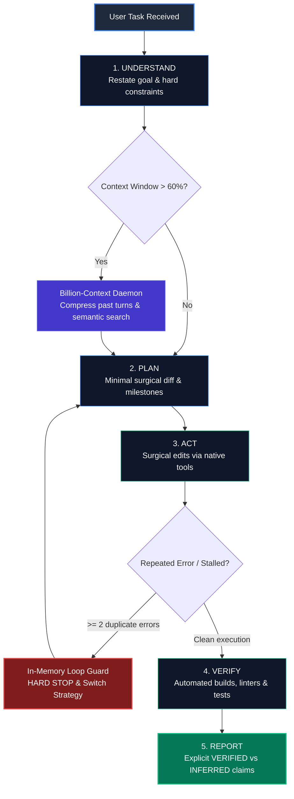

# Local-Model-Booster (for Bionic & Claude Code with LM Studio)

<div align="center">

[](LICENSE)
[](README.md)
[](README.md)
[](README.md)
[](README.md)
[](README.md)
[](docs/CLAUDE_CODE.md)
[](README.md)

</div>

> **Supercharge local 27B-class LLMs (Qwen3.8-27B Uncensored HauhauCS Aggressive MTP on RTX 3090 24GB + 32GB RAM) into disciplined, high-speed, evidence-driven autonomous software engineers — fully compatible with both the Bionic GUI Agent and Anthropic's Claude Code CLI using LM Studio & Billion-Context.**

---

## 🧭 Multi-OS Compatibility Notice

> [!NOTE]
> **Currently Optimized for Windows**: The automated 1-click installer (`.bat`, `.ps1`), Windows Scheduled Tasks, and CLI launchers (`bt.cmd`) are tailored for Windows 10/11 x64 systems.
>
> 🐧 🍎 **Linux / macOS Support**: The core skills, architectural principles, Mermaid flows, and Billion-Context proxy are cross-platform compatible. Native Bash scripts and systemd / launchd service templates are planned and community contributions are warmly welcomed!

---

## 🏛️ Master Architecture & Execution Flow

The core engine operates on a disciplined 5-phase loop with integrated context compression and in-memory zero-loop protection:



---

## 🥊 The Local 27B Reality: Constraints vs Cloud Giants & Our Solutions

> 🎯 **Real-World Benchmark Metric**: On complex real-world software engineering, multi-file refactoring, tool orchestration, and binary reverse engineering, this boosted local Qwen 3.8 27B architecture achieves **80% to 85% of Claude Sonnet 4.6 capabilities** — running 100% locally, air-gapped, on a single consumer NVIDIA RTX 3090 (24GB VRAM) with zero subscription fees and zero data leakage.

Running autonomous agents on consumer hardware presents fundamentally different physics than querying proprietary frontier models hosted in multi-million-dollar cloud datacenters:

| Dimension | Datacenter Cloud Titans (Claude 4.6 Sonnet / Opus, o3 / GPT-5, DeepSeek R1) | Raw Local 27B (Qwen 3.8 on 1x RTX 3090 24GB) | **Local-Model-Booster Architectural Solution** |
| :--- | :--- | :--- | :--- |
| **Compute & Infrastructure** | Massive datacenter clusters (NVIDIA H100, Blackwell B200 / GB200 NVL72, >1,000 GB VRAM) | Single consumer GPU (24GB VRAM + 32GB System RAM) | **100% GPU Offload (65/65 layers)** with `q8_0` KV cache + Flash Attention + FastMTP speculative decoding (~70-76 t/s). |
| **Tool Schema Capacity** | 200K - 2M token context windows; easily ingests hundreds of raw tool definitions | **Crashes immediately** at 128K context if 207 raw tool schemas (262,751 tokens) are loaded | **REA Meta-Gateway (912 tokens)**: 99.6% schema reduction, while preserving 100% access to all 207 tools on-demand via `rea_catalog` and `rea_run`. |
| **Output Data Floods** | Burns millions of cloud tokens streaming megabyte disassemblies into context | KV cache exhausts, TTFT skyrockets, model loses context coherence and loops | **NVMe SQLite FTS5 Evidence Store (`C:\REA-Context`)**: Intercepts dumps directly to NVMe disk; feeds back compact summaries (<120 tokens) with evidence IDs (`EV-XXXX`). |
| **Search in Outputs** | Re-reads entire raw dumps in prompt context at massive API token cost | Severe attention degradation and memory saturation | **Sub-millisecond FTS5 index** (<11 ms lookup); agent reads only surgical slices (`rea_read_chunk`) on exact relevant line ranges. |
| **Multi-Turn Reasoning** | Unconstrained CoT with massive cloud budgets | `preserve_thinking: true` causes cumulative reasoning bloat across 30+ turns | **Strict Thinking Ceilings (500–4,000 tokens)** + In-Memory Zero-Loop Guard + Billion-Context Proxy. |
| **Reverse Engineering** | Cannot send sensitive, proprietary, or anti-cheat protected binaries to cloud APIs | Reversing 226MB binaries offline traditionally requires manual human GUI interaction | **100% Air-Gapped Local Analysis**: Reverse engineers binaries completely offline; auto-exports color-coded IDAPython triage scripts (`Alt + F7`). |
| **Privacy & Cost** | $3.00 - $30.00+ per million tokens; prompts retained / inspected / rate-limited | **$0.00 / month**; completely private, offline, uncensored, and unthrottled | **Zero cloud dependency**; runs forever on local electricity with zero data leakage. |

---

## 🏛️ The Three Pillars of Local-Model-Booster

Local-Model-Booster is not just a reverse engineering tool — it is a complete, three-pillar autonomous operating system:

### 🛠️ Pillar 1: Full-Stack Autonomous Software Engineering (`bt.cmd` / `bt.ps1`)
Equips the local model with 35 surgical Windows CLI developer tools with native PowerShell argument forwarding:
- **`bt repo-map`**: Extracts a high-density, token-efficient outline of the workspace structure and exported symbols before touching any code.
- **`bt find-symbol -Pattern "X"`**: Pinpoints functions, classes, and declarations across large projects without flooding the context window.
- **`bt read-range -Path <file> -Start <N> -End <M>`**: Reads surgical line slices instead of dumping entire 2,000-line source files.
- **`bt run-checks`**: Auto-detects project types (.NET, Node.js, Python, Rust, Go) and executes builds, linters, and test suites with hard output capping.
- **`bt find-leftovers`**: Scans edits for lazy LLM shortcuts like `// ... rest of code unchanged`, placeholder TODOs, and syntax regressions.
- **`bt git-checkpoint`**: Automatically commits safe micro-checkpoints before risky refactors with instant one-command rollback.

### 🧠 Pillar 2: In-Memory Zero-Loop Guard & Cognition Discipline
Eliminates the two fatal weaknesses of local reasoning models: infinite loops and context drift:
- **Calibrated Thinking Ceilings**: Enforces razor-sharp reasoning budgets (300 tokens for trivial tasks, 1,500 for single edits, 4,000 max for complex multi-tool calls). Prevents reasoning blocks from filling the 128K KV cache.
- **Hard In-Memory Zero-Loop Guard**: Halts execution instantly if:
  1. The exact same tool call is invoked twice.
  2. The same compiler/runtime error repeats after an attempted fix.
  3. Three consecutive tool calls yield no new evidence.
- **Billion-Context Daemon Integration**: Coordinates with the background Billion-Context proxy (`http://127.0.0.1:8787`) to compress conversational history and maintain long-term recall across 50+ turns.

### ⚡ Pillar 3: Binary Reverse Engineering & NVMe Storage Engine
Enables local models to autonomously reverse engineer massive commercial software (e.g. 226 MB Unreal Engine 5 binaries, Themida dumps, and native DLLs):
- **99.6% Schema Reduction**: Slashes 262,751 tokens of raw `rea-agents` schemas down to **912 tokens** across 5 surgical meta-tools (`rea_catalog`, `rea_run`, `rea_search_evidence`, `rea_read_chunk`, `rea_export_ida`).
- **NVMe SQLite FTS5 Storage (`C:\REA-Context`)**: Intercepts megabyte-sized disassembly outputs directly to NVMe SSD storage. Indexes full text in SQLite FTS5 (<11 ms search) and feeds back compact summaries (<120 tokens) with evidence tracking IDs (`EV-XXXX`).
- **Automated Visual IDAPython Exporter (`bt re-ida-export`)**: Exports complete triage findings into an IDAPython script (`C:\REA-Context\ida_patch.py`) ready for IDA Pro `Alt + F7` with color-coded routine highlighting:
  - 🔴 **Red (`0x3333ff`)**: Critical Injection, Stealth & Hooking routines.
  - 🟠 **Orange (`0x0078ff`)**: Cryptography, Decryption & Obfuscation routines.
  - 🔵 **Blue (`0xff8000`)**: Network C2, Sockets & Data Exfiltration.
  - 🟢 **Green (`0x33cc33`)**: Safe initialization and standard engine routines.

---

## 🌟 The 10 Core Architectural Superpowers of Local-Model-Booster

1. **Master Operating System (`bionic-booster`)**: An all-in-one consolidated skill implementing the strict `UNDERSTAND -> PLAN -> ACT -> VERIFY -> REPORT` execution loop, razor-sharp thinking ceilings, and reverse-engineering autonomy.
2. **99.6% MCP Schema Reduction (912 Tokens)**: Slashes 262,751 tokens of tool schemas down to 912 tokens, enabling 128K local models to operate with 207 tools without context overflow.
3. **NVMe SQLite FTS5 Evidence Store (`C:\REA-Context`)**: Intercepts megabyte-sized disassemblies and dumps onto NVMe storage with sub-millisecond FTS5 search (<11 ms), returning concise metadata summaries.
4. **Automated Visual IDAPython Exporter (`bt re-ida-export`)**: Autonomous offline analysis that outputs color-coded IDA Pro annotation scripts (`Alt + F7`).
5. **Calibrated Reasoning Ceilings**: Strict thinking budgets (500–4,000 tokens for tool use) preventing reasoning loops and preserving KV cache across 50+ conversation turns.
6. **In-Memory Zero-Loop Guard**: Hard-coded in-memory break rule (stops immediately if the same tool call or error occurs twice) without spawning external shell scripts.
7. **Real-Time Context Compression (Billion-Context)**: Coordinates the 128K native context window with the local Billion-Context proxy daemon for hierarchical memory compression.
8. **6 Production-Tuned Hardware Profiles**: Calibrated presets for Coding (`01_coding`), Tool Use (`03_tool_use`), Max Intelligence, and Max Speed with instant desktop `.bat` switchers.
9. **35 Windows CLI Helper Tools (`bt.cmd` / `bt.ps1`)**: Safe, capped tools with native PowerShell argument forwarding for repo mapping, symbol search, and binary triage.
10. **Turnkey 1-Click Automated Installer**: A zero-config automated setup script (`installer/install.bat`) that installs Billion-Context, registers background services, configures dual MCP registries without UTF-8 BOM corruption, and initializes the NVMe store.

---

## 🚀 Quick Start (1-Click Automated Setup)

Ensure **Bionic / LM Studio** is installed and the target model (`Qwen3.8-27B-Uncensored-HauhauCS-Aggressive-Q4_K_P.gguf`) is downloaded.

Simply run:
```cmd
installer\install.bat
```
*(Or via PowerShell: `powershell -ExecutionPolicy Bypass -File installer\install.ps1`)*

### What the 1-Click Installer Does:
1. Installs and configures the **Billion-Context daemon** on port `8787` and registers the silent Windows Scheduled Task `BiliProxyService` (auto-starts on boot).
2. Configures dual MCP registries (`~/.lmstudio/mcp.json` and Bionic internal `~/.lmstudio/apps/bionic/.internal/ng-mcp.json`) with `billion-context` and the lightweight **`REA Meta-Gateway`** (saving > 260,000 tokens of prompt bloat).
3. Pre-creates the persistent NVMe Evidence Store directories (`C:\REA-Context\sessions` and `C:\REA-Context\logs`).
4. Deploys all 6 tuned JSON profiles to `C:\tools\profiles\`, installs desktop `.bat` switchers, and activates `01_coding` as default.
5. Deploys the master **`bionic-booster`** and all 33 modular skills to `~/.lmstudio/skills\`.
6. Adds `C:\tools\` to the Windows User & Machine `PATH` so `bt <tool>` works anywhere via `bt.cmd` and `bt.ps1`.

> [!NOTE]
> **Claude Code CLI is Optional**: The 1-click installer automates setup specifically for **Bionic / LM Studio**, Billion-Context, and the 35 helper tools. It **does NOT** install or configure Anthropic's Claude Code CLI.
> If you wish to connect Claude Code CLI to your local setup, it is completely optional — simply follow the standalone configuration steps in [docs/CLAUDE_CODE.md](docs/CLAUDE_CODE.md).

---

## 🧭 Supported Agent Frontends

Local-Model-Booster supports two first-class autonomous agent interfaces:

### 1. 🤖 Bionic Agent (LM Studio GUI) — Default & Automated
1. Open **Bionic** $\rightarrow$ Click **Settings** (gear icon bottom left) $\rightarrow$ **Skills** (*Compétences Bionic*).
2. **Recommended Setting**: Leave **ONLY `Bionic Booster`** checked (uncheck the other modular skills to avoid injecting ~5,000 characters of extra descriptions into every prompt).
3. The master `Bionic Booster` skill already includes:
   - Operating rules & 5-phase loop
   - Thinking budget ceilings
   - 128K context & Billion-Context proxy coordination
   - In-memory zero-loop guard
   - Precise surgical code editing
   - Direct access to the 35 CLI helper tools (`C:\tools\bt.cmd`)
4. Any modular skill can still be summoned on-demand anytime in chat by typing `@<skill-name>`.

### 2. ⚡ Claude Code CLI (Anthropic Terminal Agent) — Optional
Anthropic's official **Claude Code CLI** is an optional frontend that runs seamlessly against your local LM Studio / Bionic server using **Billion-Context** real-time conversation compression:
1. **Proxy Config**: Set `context: 98304` in `~/.config/billion-context/billion-context.json`.
2. **Claude Config**: Configure `ANTHROPIC_BASE_URL: "http://127.0.0.1:8787/bili/http://127.0.0.1:1235"` and map model tiers in `~/.claude/settings.json`.
3. **One-Command Launch**: Add the provided PowerShell session-tracking wrapper functions to `$PROFILE` and launch with `bclaude`.
📖 *See the step-by-step reproduction and verification guide in [docs/CLAUDE_CODE.md](docs/CLAUDE_CODE.md).*

---

## 🛠️ Hardware & Profiles Reference

| Profile | ID | Context | Reasoning Budget | Temp / Top_P | KV Cache | Purpose |
| :--- | :--- | :--- | :--- | :--- | :--- | :--- |
| **Coding (Default)** | `01_coding` | 131,072 | 16,384 | 0.6 / 0.95 | `q8_0` | High-precision coding, bug fixing, refactoring, and general chat. |
| **General Operation** | `02_general_operation` | 98,304 | 8,192 | 0.7 / 0.80 | `q8_0` | Fast interactive assistant, balanced reasoning. |
| **Tool Use** | `03_tool_use` | 98,304 | 4,096 | 0.3 / 0.90 | `q8_0` | Strict JSON schema adherence, deterministic tool arguments. |
| **Long Tasks** | `04_long_tasks` | 131,072 | 8,192 | 0.5 / 0.90 | `q4_0` | Massive codebases (>50K tokens); maximizes VRAM safety. |
| **Max Intelligence** | `05_max_intelligence` | 131,072 | 24,576 | 0.7 / 0.95 | `q8_0` | Complex algorithm design, difficult proofs, deep reasoning. |
| **Max Speed** | `06_max_speed` | 65,536 | 0 (Off) | 0.7 / 0.80 | `q8_0` | Maximum throughput (~68-75 t/s), direct instruct generation. |

Switch profiles anytime via `C:\tools\switch_*.bat` desktop shortcuts or `switch_profile.ps1 -Profile <name>`.

---

## 📂 Repository Structure

```text
Local-Model-Booster/
├── .github/
│   ├── ISSUE_TEMPLATE/
│   │   ├── bug_report.yml        <-- Structured bug reporting form
│   │   └── feature_request.yml   <-- Feature & profile suggestion form
│   └── PULL_REQUEST_TEMPLATE.md  <-- Clean pull request checklist
├── installer/
│   ├── install.bat               <-- 1-Click double-click Windows installer
│   ├── install.ps1               <-- Complete PowerShell setup automation
│   └── README.md                 <-- Installer guide
├── skills/
│   ├── bionic-booster/           <-- Master all-in-one Bionic booster skill
│   ├── booster-core/             <-- Core operating system & skill router
│   └── [31 Modular Skills]/      <-- Specialized skills (loop-guard, context, etc.)
├── configs/
│   ├── profiles/                 <-- 6 tuned JSON profile configs
│   └── LMSTUDIO-3090-TUNING.md   <-- Verified hardware and VRAM benchmarks
├── tools/                        <-- 35 Windows CLI helper tools (bt.cmd, repo-map, etc.)
├── templates/                    <-- STATE.md, PLAN.md, MEMORY.md templates
├── docs/
│   ├── Tutorial.md               <-- Complete step-by-step guide
│   ├── CLAUDE_CODE.md            <-- Claude Code + LM Studio + Billion-Context setup guide
│   ├── TEST_PROMPTS.md           <-- Verification prompts for each profile
│   ├── DIAGRAMS.md               <-- Mermaid workflow diagrams for every skill
│   └── TOOLS.md                  <-- CLI tools reference manual
├── scripts/
│   └── validate_skills.py        <-- Automated skill validation script
└── LICENSE                       <-- MIT License
```

---

## 🧪 Automated Skill Validation (`validate_skills.py`)

A built-in Python test suite is provided to ensure all Bionic skills conform to strict quality, formatting, and tool-linkage standards.

### When to run it:
- **Before opening a Pull Request or committing changes** to any skill in `skills/`.
- **After adding a new modular skill** or editing `SKILL.md` frontmatter.
- **After modifying or adding tools** in `tools/` to ensure no broken `bt <tool>` references exist.

### What it checks automatically:
1. **Frontmatter Integrity**: Verifies valid YAML headers, exact folder/name matches, and allowed keys.
2. **Description Quality**: Ensures description lengths are between 40 and 1,024 characters for clear agent router matching.
3. **Mermaid Flowchart Presence**: Verifies every skill folder contains an associated architectural `diagram.mmd`.
4. **Tool Linkage (`bt` references)**: Scans every `SKILL.md` for references to `bt <tool>` and verifies the corresponding PowerShell script exists in `tools/<tool>.ps1`.

### How to execute:
```bash
python scripts/validate_skills.py
```
*Expected output when all 33 skills pass:*
```text
33 skills, 100425 chars
OK
```

---

## 📜 Acknowledgements & Credits

- **[Billion-Context](https://github.com/ranxianglei/billion-context)** by [ranxianglei](https://github.com/ranxianglei) (MIT License): An outstanding, lightweight context compression proxy that makes true long-context reasoning possible on consumer hardware. We are deeply grateful to the developers for building this great tool!
- **[HauhauCS](https://huggingface.co/HauhauCS)**: Creator of the `Qwen3.8-27B-Uncensored-HauhauCS-Aggressive-MTP-GGUF` model and custom `Q4_K_P` quants.
- **[Qwen Team / Alibaba](https://github.com/QwenLM)**: For the groundbreaking Qwen architecture and open weights.
- **[LM Studio](https://lmstudio.ai/) & Bionic**: For providing the local inference and agent runtime.
- **[morluto/rea](https://github.com/morluto/rea)**: For foundational concepts in reverse-engineering agent workflows.

---

## ⚖️ Legal Disclaimer & End-User Responsibility Notice

This project, its documentation, skills, and command-line helper tools are provided exclusively for **authorized software engineering, defensive security auditing, interoperability analysis, and research on software you own or have explicit permission to inspect**.

1. **Owner Rights & Sole Responsibility**:
   - The end-user/operator of this software acknowledges and agrees that they are **solely, individually, and legally responsible** for any and all actions, executions, analyses, or derivative works performed using these tools.
   - When inspecting, debugging, or reverse-engineering applications, game binaries, or memory layouts, the user affirms that they either **own the target software**, possess explicit authorization from the rights holder, or are operating within lawful statutory exceptions (such as legitimate reverse engineering for interoperability, personal ownership rights, or defensive vulnerability research).
2. **"AS-IS" Warranty Disclaimer**:
   - As declared in the [MIT License](LICENSE), this software is provided *"AS IS", without warranty of any kind, express or implied*. Under no circumstances shall the authors, maintainers, or contributors be held liable for any claim, damages, or legal consequences arising from the use, misuse, or application of this software by the end-user.

---

## 📄 License

This project is licensed under the [MIT License](LICENSE).

