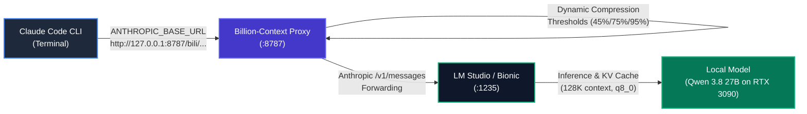

# Claude Code + LM Studio + Billion-Context Integration Guide

> **Complete guide to connecting Anthropic's Claude Code CLI to local LLMs (LM Studio / Bionic) with Billion-Context real-time context compression on Windows 10/11.**

---

## 📑 Table of Contents
1. [Architecture & How It Works](#1-architecture--how-it-works)
2. [Verified Environment & Baseline](#2-verified-environment--baseline)
3. [Prerequisites](#3-prerequisites)
4. [Step 1: Install Billion-Context](#step-1-install-billion-context)
5. [Step 2: LM Studio Server & Model Preparation](#step-2-lm-studio-server--model-preparation)
6. [Step 3: Configure Billion-Context Proxy](#step-3-configure-billion-context-proxy)
7. [Step 4: Configure Claude Code (`settings.json`)](#step-4-configure-claude-code-settingsjson)
8. [Step 5: Automated Startup Script & PowerShell Profile](#step-5-automated-startup-script--powershell-profile)
9. [Step 6: End-to-End Verification Steps](#step-6-end-to-end-verification-steps)
10. [Troubleshooting & Gotchas](#10-troubleshooting--gotchas)
11. [Critical Do's and Don'ts](#11-critical-dos-and-donts)
12. [Quick Reference Cheat Sheet](#12-quick-reference-cheat-sheet)

---

## 1. Architecture & How It Works

Claude Code CLI normally connects exclusively to Anthropic's cloud endpoints (`api.anthropic.com`). This integration reroutes Claude Code through **Billion-Context** (`bili`), which compresses conversational history on-the-fly, and forwards requests to **LM Studio / Bionic** via its Anthropic-compatible `/v1/messages` endpoint:



### Key Mechanisms:
- **Upstream Forwarding**: Claude Code is pointed to `http://127.0.0.1:8787/bili/http://127.0.0.1:1235` via `ANTHROPIC_BASE_URL`.
- **Context Ceiling Declaration**: Because local inference servers do not automatically broadcast hardware-sustainable context limits over HTTP headers, the proxy requires an explicit `context` parameter in `billion-context.json`.
- **Sub-Agent & Background Model Mapping**: Claude Code internally issues background requests for `opus`, `sonnet`, and `haiku`. All tiers are mapped directly to your local model ID in `settings.json` to prevent `404 / model_not_found` errors.

---

## 2. Verified Environment & Baseline

| Parameter | Tested Value | Notes |
| :--- | :--- | :--- |
| **Operating System** | Windows 10 / 11 x64 | PowerShell 5.1 / PowerShell 7+ |
| **LM Studio / Bionic** | v0.4.1+ (serving port `1235`) | Default port is `1234`; our stack uses `1235` |
| **Target Model** | `qwen3.8-27b-uncensored-hauhaucs-aggressive-mtp` | High-quality tool calling & agent reasoning |
| **Loaded Context** | `98304` to `131072` tokens | Loaded in LM Studio runtime with `q8_0` KV cache |
| **Declared Proxy Window** | `98304` tokens | Sustainable ceiling for VRAM stability |
| **Billion-Context Port** | `8787` | Default proxy port |
| **Claude Code Version** | Official CLI (`@anthropic-ai/claude-code`) | Latest npm release |

---

## 3. Prerequisites

1. **Node.js & npm**: Verified with `v20.x` or `v22.x` installed in `C:\Program Files\nodejs\node.exe`.
2. **Claude Code CLI**: Installed globally via `npm install -g @anthropic-ai/claude-code`.
3. **LM Studio 0.4.1 or newer**: Ensure local server features and `/v1/messages` endpoint support are available.
4. **Target Model Loaded**: A model with verified tool-calling capabilities (e.g. Qwen 3.8 27B or similar), loaded with sufficient context.

---

## 4. Step 1: Install Billion-Context

Run in PowerShell or Command Prompt:

```powershell
npm install -g billion-context
```

Verify installation:
```powershell
bili --help
```

> [!NOTE]
> On Windows, npm global packages install to `%APPDATA%\npm\node_modules\billion-context\dist\index.js`. No administrative privileges are required.

---

## 5. Step 2: LM Studio Server & Model Preparation

1. **Load Your Model**:
   - In LM Studio / Bionic, set **Context Length** to your target size (e.g., `98304` or `131072`).
   - Claude Code system prompts and tool schemas are substantial, so avoid low defaults (e.g., 2048 or 4096).
2. **Start the Local Server**:
   - In the Developer / Local Server tab, start the server on port `1235` (or use `lms server start --port 1235`).
3. **Retrieve the Exact Model Identifier**:
   ```powershell
   curl.exe http://127.0.0.1:1235/v1/models
   ```
   *Note: Always use `curl.exe` in PowerShell to invoke the actual binary rather than the `Invoke-WebRequest` alias.*
4. **Use `127.0.0.1` Exclusively**:
   Do **not** use `localhost`. On Windows, `localhost` may resolve to `::1` (IPv6), causing host matching mismatches inside Billion-Context's provider map.

---

## 6. Step 3: Configure Billion-Context Proxy

Start `bili` once from terminal to initialize its directories, then stop it (`Ctrl+C`):
```powershell
bili
```

Config file location:
```text
%USERPROFILE%\.config\billion-context\billion-context.json
```
*(Full path: `C:\Users\<Username>\.config\billion-context\billion-context.json`)*

Edit `billion-context.json` with the following configuration:

```json
{
  "port": 8787,
  "host": "127.0.0.1",
  "providers": {
    "http://127.0.0.1:1235": {
      "models": {
        "qwen3.8-27b-uncensored-hauhaucs-aggressive-mtp": {
          "context": 98304
        }
      }
    }
  }
}
```

### Critical Rules for Config:
- **Provider URL**: Must match `http://127.0.0.1:1235` character-for-character.
- **Model Key**: Must exactly match the model ID returned by `/v1/models`.
- **`context` Value**: Declare your **sustainable ceiling** (`98304`). Billion-Context triggers automatic compression at **45%** and forced compression at **75%** of this value, protecting your GPU VRAM before inference memory strains.

---

## 7. Step 4: Configure Claude Code (`settings.json`)

Edit your global Claude Code configuration:
```text
%USERPROFILE%\.claude\settings.json
```
*(Full path: `C:\Users\<Username>\.claude\settings.json`)*

Merge or update the `"env"` and `"model"` blocks:

```json
{
  "env": {
    "ANTHROPIC_BASE_URL": "http://127.0.0.1:8787/bili/http://127.0.0.1:1235",
    "ANTHROPIC_AUTH_TOKEN": "lmstudio",
    "ANTHROPIC_MODEL": "qwen3.8-27b-uncensored-hauhaucs-aggressive-mtp",
    "ANTHROPIC_DEFAULT_OPUS_MODEL": "qwen3.8-27b-uncensored-hauhaucs-aggressive-mtp",
    "ANTHROPIC_DEFAULT_SONNET_MODEL": "qwen3.8-27b-uncensored-hauhaucs-aggressive-mtp",
    "ANTHROPIC_DEFAULT_HAIKU_MODEL": "qwen3.8-27b-uncensored-hauhaucs-aggressive-mtp",
    "CLAUDE_CODE_ATTRIBUTION_HEADER": "0",
    "DISABLE_AUTO_COMPACT": "1",
    "CLAUDE_CODE_DISABLE_NONESSENTIAL_TRAFFIC": "1",
    "NO_PROXY": "127.0.0.1,localhost"
  },
  "model": "qwen3.8-27b-uncensored-hauhaucs-aggressive-mtp"
}
```

### Explanation of Environment Variables:

| Environment Variable | Purpose |
| :--- | :--- |
| `ANTHROPIC_BASE_URL` | Routes Claude Code through Billion-Context forwarding syntax: `http://127.0.0.1:8787/bili/<Upstream_URL>`. |
| `ANTHROPIC_AUTH_TOKEN` | Set to dummy string `"lmstudio"` (or your LM Studio API token if authentication is enabled). |
| `ANTHROPIC_MODEL` | Specifies the primary reasoning model. |
| `ANTHROPIC_DEFAULT_*_MODEL` | Maps Claude Code's internal tier requests (`opus`, `sonnet`, `haiku`) to your local model, preventing 404 errors. |
| `CLAUDE_CODE_ATTRIBUTION_HEADER=0` | Disables attribution headers for optimal KV cache prefix caching. |
| `DISABLE_AUTO_COMPACT=1` | Disables Claude Code's internal compaction so it does not conflict with Billion-Context. |
| `CLAUDE_CODE_DISABLE_NONESSENTIAL_TRAFFIC=1` | Suppresses external telemetry calls to `api.anthropic.com`. |
| `NO_PROXY` | Guarantees loopback requests never route into external system proxies. |

> [!WARNING]
> Ensure `settings.json` does **NOT** contain a `hooks` entry pointing to `claude-native-bootstrap.js`. That hook belongs to an alternative experimental routing mechanism and will trigger `403 tunnel_destination_denied` loops.

---

## 8. Step 5: Automated Startup Script & PowerShell Profile

To avoid connection errors, Billion-Context must be listening on port `8787` before Claude Code launches.

### Add Helper Functions to `$PROFILE`:
Open your PowerShell profile:
```powershell
if (!(Test-Path $PROFILE)) { New-Item -Path $PROFILE -ItemType File -Force }
notepad $PROFILE
```

Paste the following session-tracking wrapper functions into your profile:

```powershell
$global:BiliHealth   = 'http://127.0.0.1:8787/__bili/health'
$global:BiliSessions = Join-Path $env:TEMP 'bili-sessions'

function Test-Bili {
    try { Invoke-RestMethod $global:BiliHealth -TimeoutSec 1 | Out-Null; $true } catch { $false }
}

function Start-Bili {
    if (Test-Bili) { return }
    $node = 'C:\Program Files\nodejs\node.exe'
    $bili = "$env:APPDATA\npm\node_modules\billion-context\dist\index.js"
    Start-Process -FilePath $node -ArgumentList "`"$bili`"", 'start' -WindowStyle Hidden
    for ($i = 0; $i -lt 30; $i++) {
        Start-Sleep -Milliseconds 500
        if (Test-Bili) { return }
    }
    Write-Warning 'bili did not become healthy on port 8787'
}

function Stop-Bili {
    Get-CimInstance Win32_Process -Filter "Name='node.exe'" |
        Where-Object { $_.CommandLine -like '*billion-context*' } |
        ForEach-Object { Stop-Process -Id $_.ProcessId }
}

function Enter-BiliSession {
    New-Item -ItemType Directory -Force -Path $global:BiliSessions | Out-Null
    Set-Content -Path (Join-Path $global:BiliSessions "$PID.txt") -Value (Get-Date)
}

function Exit-BiliSession {
    Remove-Item (Join-Path $global:BiliSessions "$PID.txt") -ErrorAction SilentlyContinue
    $alive = Get-ChildItem $global:BiliSessions -Filter *.txt -ErrorAction SilentlyContinue |
        Where-Object {
            if (Get-Process -Id ([int]$_.BaseName) -ErrorAction SilentlyContinue) { $true }
            else { Remove-Item $_.FullName -ErrorAction SilentlyContinue; $false }
        }
    if (-not $alive) { Stop-Bili }
}

function claude {
    Enter-BiliSession
    try {
        Start-Bili
        $exe = Get-Command claude -CommandType Application | Select-Object -First 1 -ExpandProperty Source
        & $exe @args
    } finally {
        Exit-BiliSession
    }
}

function bclaude {
    Enter-BiliSession
    try {
        Start-Bili
        bili claude @args
    } finally {
        Exit-BiliSession
    }
}
```

Reload your profile:
```powershell
. $PROFILE
```

### 🧠 How the Session Lifecycle Manager Works:
- **Reference-Counted Session Markers**: Each `claude` or `bclaude` launch writes a marker file named after the active PowerShell window's Process ID (`$PID.txt`) into `%TEMP%\bili-sessions\`.
- **Automatic Multi-Window Safety**: If you run multiple Claude Code terminal windows concurrently, closing one window will **not** kill the proxy for another window that is still actively working.
- **Auto-Stop on Last Exit**: When Claude exits (`/exit`, `Ctrl+C`, or normal termination), the marker is removed and any stale markers from terminated windows are purged. If no live sessions remain, `Stop-Bili` terminates the proxy automatically.
- **Dead Window Garbage Collection**: If a window crashed or was closed abruptly, the next session automatically cleans up orphaned markers by verifying whether the PID is still alive.

### 💡 Important Details to Know:
- **Closing via the `X` Window Button**: Closing the terminal window directly via the `X` button kills PowerShell immediately before `finally` blocks can execute. In that event, `bili` stays running until your next Claude session exits (which cleans up stale PID markers and stops it), or you can execute `Stop-Bili` manually.
- **Startup Latency**: When no proxy is running, launching Claude takes a few seconds while `bili` boots up in the background. Compression state is safely persisted to disk, and conversations seamlessly reattach to past sessions across restarts.
- **Verification**: Run `claude` (or `bclaude`), exit via `/exit`, and then test:
  ```powershell
  curl.exe -s http://127.0.0.1:8787/__bili/health
  ```
  It should fail to connect, confirming the daemon shut down cleanly once the last session left.

---

## 9. Step 6: End-to-End Verification Steps

Test every link in the chain in sequence:

### 1. Test LM Studio Directly
```powershell
curl.exe http://127.0.0.1:1235/v1/models
```
*Expected*: Valid JSON listing your loaded model.

### 2. Test Billion-Context Proxy Health
```powershell
curl.exe -s http://127.0.0.1:8787/__bili/health
```
*Expected*: `{"ok":true}`.

### 3. Test LM Studio Through Billion-Context Proxy
```powershell
curl.exe http://127.0.0.1:8787/bili/http://127.0.0.1:1235/v1/models
```
*Expected*: Same model list as Step 1.

### 4. Test Anthropic Chat Endpoint Through Proxy
Run this in `cmd.exe` (to ensure clean JSON escaping), replacing `MODEL_ID` with your model name:
```cmd
curl.exe http://127.0.0.1:8787/bili/http://127.0.0.1:1235/v1/messages -H "content-type: application/json" -H "x-api-key: lmstudio" -H "anthropic-version: 2023-06-01" -d "{\"model\":\"qwen3.8-27b-uncensored-hauhaucs-aggressive-mtp\",\"max_tokens\":50,\"messages\":[{\"role\":\"user\",\"content\":\"Reply with: Hello from local model\"}]}"
```
*Expected*: Anthropic-formatted message response containing the text.

### 5. Launch Claude Code
```powershell
bclaude
```
Ask a test question (e.g. `"Explain binary search in 2 bullet points"`).

### 6. Monitor in Real Time
Open the Billion-Context Dashboard in your browser:
```text
http://127.0.0.1:8787
```
Check active sessions, tokens compressed, and compression events.

---

## 10. Troubleshooting & Gotchas

| Symptom | Probable Cause | Exact Solution |
| :--- | :--- | :--- |
| **`403 tunnel_destination_denied` (detail: `self`)** | Self-loop routing: A native hook, plugin, or `HTTP_PROXY` variable is forcing port 8787 to loop into itself. | 1. Remove `claude-native-bootstrap.js` hook from `settings.json`.<br/>2. Run `bili plugin remove claude`.<br/>3. Verify `NO_PROXY=127.0.0.1,localhost`. |
| **`"Please run /login"`** | Claude Code received a 400/401/404 API error from upstream and defaulted to its login prompt. | **Do NOT run `/login`**. Check LM Studio logs and proxy logs to identify the underlying HTTP error. |
| **`Connection refused` on `8787`** | Billion-Context daemon is not running. | Run `Start-Bili` or start manually via `bili start`. |
| **`Model not found` / `404`** | Model ID mismatch or unmapped default model tier. | Ensure `ANTHROPIC_MODEL`, `ANTHROPIC_DEFAULT_OPUS_MODEL`, `ANTHROPIC_DEFAULT_SONNET_MODEL`, and `ANTHROPIC_DEFAULT_HAIKU_MODEL` are identical. |
| **Compression never triggers** | Mismatch between declared provider key and request URL, or model context not reached. | Ensure `http://127.0.0.1:1235` is identical in both `billion-context.json` and `ANTHROPIC_BASE_URL`. |
| **`mitm api.anthropic.com` log lines** | A background client is attempting to use `8787` as a generic HTTP proxy. | Ensure `CLAUDE_CODE_DISABLE_NONESSENTIAL_TRAFFIC=1` is set in `settings.json`. |
| **Empty output or tool errors** | Context is too small or model output tokens capped. | Ensure model is loaded with at least `98304` tokens and client `max_tokens` is adequate. |
| **Port 8787 already in use** | A dangling `node.exe` instance is running. | Run `Stop-Bili` in PowerShell or terminate orphaned node processes in Task Manager. |
| **PowerShell function not found** | Execution policy prevents script loading. | Run `Set-ExecutionPolicy -Scope CurrentUser RemoteSigned` once. |

---

## 11. Critical Do's and Don'ts

- ✅ **DO** use one routing method only: the `/bili/` URL in `ANTHROPIC_BASE_URL`.
- ❌ **DO NOT** run `bili plugin install claude` or install `/billion-context:bili-setup` simultaneously. Those configure native hooks that conflict with upstream proxy URLs.
- ❌ **DO NOT** leave excessive unused plugins enabled in Claude Code. Every tool schema is injected into the context window on every turn.
- ✅ **DO** exclude Billion-Context session storage from antivirus live scanning:
  Add `%USERPROFILE%\.local\share\billion-context\` to Windows Defender exclusions to prevent file locks during turn commits.

---

## 12. Quick Reference Cheat Sheet

| Item | Path or Command |
| :--- | :--- |
| **Claude Code Settings** | `%USERPROFILE%\.claude\settings.json` |
| **Billion-Context Config** | `%USERPROFILE%\.config\billion-context\billion-context.json` |
| **Billion-Context Log** | `%USERPROFILE%\.local\state\billion-context\bili.log` |
| **Billion-Context Session Data** | `%USERPROFILE%\.local\share\billion-context\` |
| **Web Dashboard** | `http://127.0.0.1:8787` |
| **Health Check Endpoint** | `http://127.0.0.1:8787/__bili/health` |
| **PowerShell Launchers** | `bclaude` (recommended) or `claude` |
| **Stop Daemon** | `Stop-Bili` |
